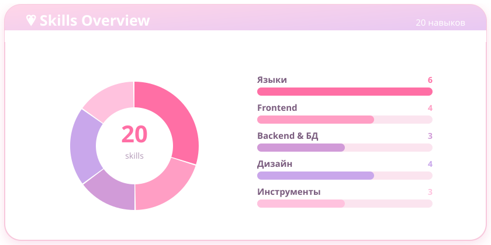

<!-- ╭──────────────────────────────  HEADER  ──────────────────────────────╮ -->


<h1 align="center">Привет, я Карина 🤍</h1>

<p align="center">
  
</p>

<p align="center">
  
  
  
  <a href="https://github.com/krna-tlgnva"></a>
</p>

<p align="center">
  &nbsp;
  &nbsp;
  &nbsp;
  &nbsp;
  
</p>

<!-- ╭──────────────────────────────  ABOUT  ──────────────────────────────╮ -->
### 💗 Обо мне

Разрабатываю веб-приложения и веду продукт целиком — от дизайна интерфейса до backend, API и базы данных. За плечами около полугода практического опыта. На фронтенде работаю с **React** и **JavaScript**, на бэкенде — **Python / FastAPI**, данные храню в **PostgreSQL** и **MongoDB**, интегрирую REST API и внешние сервисы.

```yaml
education: Astana IT University — бакалавриат, 2027
GPA:       3.55 / 4.0
stack:     React · FastAPI · PostgreSQL · MongoDB
focus:     Fullstack · UI/UX · AI-assisted development
```

<!-- ╭────────────────────────────  TECH STACK  ───────────────────────────╮ -->
### 💗 Tech Stack

<p align="center">
  
</p>

<table align="center">
  <tr>
    <td align="center"><b>💻 Языки</b></td>
    <td>
      
      
      
      
      
      
    </td>
  </tr>
  <tr>
    <td align="center"><b>🎀 Frontend</b></td>
    <td>
      
      
      
      
    </td>
  </tr>
  <tr>
    <td align="center"><b>⚙️ Backend &amp; БД</b></td>
    <td>
      
      
      
    </td>
  </tr>
  <tr>
    <td align="center"><b>🎨 Дизайн</b></td>
    <td>
      
      
      
      
    </td>
  </tr>
  <tr>
    <td align="center"><b>🛠️ Инструменты</b></td>
    <td>
      
      
      
      
    </td>
  </tr>
</table>

<!-- ╭──────────────────────────  GITHUB STATS  ───────────────────────────╮ -->
### 💗 Инфографика навыков

<p align="center">
  
</p>

<p align="center">
  
</p>

<!-- ╭────────────────────────────  LEARNING  ─────────────────────────────╮ -->
### 💗 Сейчас развиваюсь в

<p align="center">
  
  
  
  
  
</p>

Мне особенно интересны проекты, в которых можно сочетать **инженерное мышление, разработку программных продуктов, AI и качественный пользовательский интерфейс**.

<!-- ╭──────────────────────────────  FOOTER  ─────────────────────────────╮ -->
<div align="center">
  
</div>


